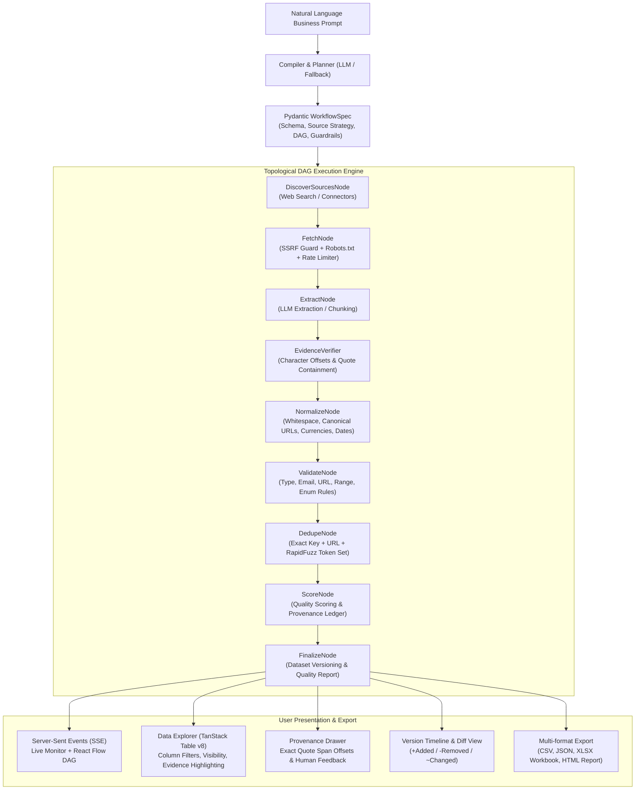

# ⚡ SchemaFlow — AI-Powered Data Intelligence Platform

> Transform natural-language business requests into verified, traceable, and structured datasets with dynamic multi-source pipelines. Built for **Code Cubicle 6.0 — Problem Statement 01: AI-Powered Data Intelligence Platform**.

[](https://www.python.org/)
[](https://fastapi.tiangolo.com)
[](https://react.dev/)
[](https://www.typescriptlang.org/)
[](tests/)

---

## 🏆 What is SchemaFlow?

SchemaFlow turns high-level business prompts (e.g., *"Collect seed-stage AI startups in India with founders, funding amount, and careers page URL"*) into an interactive, manageable collection workflow. Rather than hardcoding scrapers or blindly generating ungrounded synthetic text, SchemaFlow:

1. **Dynamically Compiles Requirements**: Infers entity models, designs schemas with type constraints, and generates DAG execution pipelines.
2. **Collects from Permitted Sources**: Discovers candidate pages via Web Search, RSS, HackerNews, GitHub, Wikipedia, arXiv, and direct URLs without bypassing authentication or login walls.
3. **Verifies Evidence Before Ingestion**: Employs **Evidence-Verified Extraction** where every single extracted attribute must be grounded in an exact, verifiable quote from source documents; unsupported or ungrounded claims are nullified or rejected.
4. **Cleans, Normalizes & Deduplicates**: Canonicalizes URLs, normalizes currencies (global `$M/$B` and Indian `₹ Cr/Lakh`), runs multi-stage field validators, and deduplicates using exact keys, canonical URLs, and fuzzy token matching.
5. **Provides Managed Task Execution**: Supports real-time pause, resume, cancel, and node-level retry with live SSE status streaming and an interactive React Flow DAG visualizer.
6. **Maintains Dataset History & Automated Schedules**: Rehydrates recurring runs via APScheduler and provides dataset run-to-run diff tracking (+Added, -Removed, ~Changed).

---

## 🏗️ Architecture & Pipeline Flow



---

## 🛡️ Evidence-Verified Extraction (Zero Hallucination Honesty)

> [!IMPORTANT]
> **We do NOT claim "zero hallucination"** because no LLM system can guarantee that mathematically. Instead, SchemaFlow enforces a strict, verifiable contract:
> 
> **"Evidence-Verified Extraction — every extracted value must be corroborated by an exact, verbatim text quote within the source document. Unsupported or ungrounded claims are nullified or rejected."**

### How Evidence Verification Works:
1. **Quote Verification**: The verifier scans the crawled HTML/text chunk to confirm that the extracted evidence quote actually exists in the source text (exact substring matching or fuzzy token similarity $\ge 90\%$).
2. **Character Offset Tracking**: Records exact character offsets (`[evidence_start, evidence_end]`) in the database, enabling interactive visual highlighting in the UI Provenance Drawer.
3. **Value Containment Check**: It verifies that the extracted field value is contained within or directly corroborated by the quote (containment, numeric equivalence, or fuzzy match $\ge 85\%$).
4. **Fail-Safe Discard & Nulling**:
   - If a **required** field lacks verified evidence, the entire candidate record is discarded.
   - If an **optional** field lacks verified evidence, its value is set to `null` rather than preserving unverified text.

---

## 🔒 Security & Ethical Crawling by Design

SchemaFlow respects web standards and protects host infrastructure:

1. **SSRF Defense**: Pre-flight DNS resolution and IP range validation. Blocks loopback (`127.0.0.1`, `localhost`), link-local/cloud metadata (`169.254.169.254`), and private RFC 1918 subnets (`10.0.0.0/8`, `172.16.0.0/12`, `192.168.0.0/16`). Re-verifies every redirection hop.
2. **robots.txt Compliance**: Checks domain `robots.txt` before fetching and records compliance events in the execution log. Disallowed paths are marked `blocked` and surfaced transparently in the Sources panel.
3. **Adaptive Token-Bucket Rate Limiting**: Enforces configurable requests-per-second per target domain (default 1.0 req/s) to avoid overwhelming remote servers.
4. **Prompt Injection Defense**: All fetched web documents are quarantined inside `<source_document>` delimiters with explicit instructions to the LLM to treat document text strictly as untrusted data.
5. **No Wall Bypassing**: Never attempts CAPTCHA bypass, residential proxy evasion, or login wall circumvention.
6. **Graceful Search Fallback**: When DuckDuckGo HTML search is rate-limited or blocked, the engine automatically falls back to secondary permitted connectors (RSS feeds, HackerNews Firebase API, Wikipedia REST API, GitHub public API, arXiv API) and logs a `web_search_fallback` compliance event.

---

## 🎭 Dual Engine Modes: Live vs. Demo Mode

SchemaFlow is built to be demo-proof and production-ready:

| Feature | Live Mode | Demo Replay Mode |
|---|---|---|
| **Compilation** | Google Gemini (`gemini-3.1-flash-lite`) dynamic planning | Deterministic offline compilation planner |
| **Data Ingestion** | Live HTTP crawling with SSRF & robots.txt enforcement | 5 shipped offline real-world fixtures |
| **DAG Pipeline** | Real topological `DagEngine` with parallel wave execution | **Real topological `DagEngine`** |
| **Evidence Verifier**| Real quote offset calculation & containment check | **Real quote offset calculation & containment check** |
| **Normalizers & Dedupe**| Real currency, date, URL normalization & RapidFuzz | **Real currency, date, URL normalization & RapidFuzz** |
| **SSE Stream** | Real-time event stream to React Flow DAG | **Real-time event stream** (choice of `fast` or `cinematic 400ms`) |
| **Internet Dependency**| Requires active internet connection & LLM API key | **100% offline-ready** (zero latency, zero Wi-Fi failure risk) |

### Shipped Demo Fixtures:
- `ai_startups_india`: Seed-stage Indian AI startups with founders, funding amounts, and locations.
- `remote_python_internships`: Remote Python developer opportunities with stipends and application links.
- `open_source_ml_repos`: Top machine learning repositories on GitHub with stars, licenses, and primary languages.
- `arxiv_rag_papers`: Recent research papers on retrieval augmented generation with authors and PDF links.
- `tech_sponsorship_opportunities`: Tech newsletters accepting sponsorships with audience sizes and rates.

---

## ⚙️ Environment Variables

Create or configure `backend/.env`:

```bash
# LLM Provider Configuration
LLM_API_KEY=your_gemini_api_key_here
LLM_BASE_URL=https://generativelanguage.googleapis.com/v1beta/openai/
LLM_MODEL=gemini-3.1-flash-lite

# Database Configuration
DATABASE_URL=sqlite:///./database.db

# Crawler & Execution Limits
CRAWLER_DEFAULT_RPS=1.0
CRAWLER_MAX_PAGES=50
CRAWLER_TIMEOUT_SECONDS=15
CRAWLER_MAX_BODY_BYTES=5242880

# Logging
LOG_LEVEL=INFO
```

*(Note: If `LLM_API_KEY` is not set or invalid, SchemaFlow automatically operates in Mock/Demo mode with clear UI status badges without crashing.)*

---

## 🚀 Quick Start Guide

### Prerequisites
- Python 3.11, 3.12, or 3.13
- Node.js 18+ and npm

### 1. Start Backend Server

```bash
cd backend
python -m venv venv

# On Windows:
.\venv\Scripts\activate
# On Linux/macOS:
source venv/bin/activate

pip install -r requirements.txt
uvicorn app.main:app --reload --port 8000
```

Verify backend health:
```bash
curl http://localhost:8000/api/v1/system/status
```

### 2. Start Frontend Application

```bash
cd frontend
npm install
npm run dev
```

Open your browser at `http://localhost:5173`.

---

## 🧪 Automated Test Suite

SchemaFlow includes comprehensive test suites covering all critical components:

```bash
cd backend
.\venv\Scripts\pytest -v
```

### Test Coverage Highlights (50/50 Passing):
- **`test_dag_engine.py`**: Topological ordering, parallel execution waves, failure isolation, cancellation, pause/resume halting, and budget stopping.
- **`test_fetcher.py`**: Tested with `respx` verifying robots.txt disallow compliance, per-domain rate limiting, SSRF redirection blocking, response size caps, and login-wall handling.
- **`test_planner.py`**: Cyclic DAG rejection via Kahn's algorithm and re-prompt recovery on invalid specs.
- **`test_verifier.py`**: Exact substring quote matching, fuzzy matching, offset calculation, containment checking, and fail-safe nulling.
- **`test_dedupe.py`**: Exact composite key deduplication, canonical URL stripping, and RapidFuzz token set ratio matching.
- **`test_normalizers.py`**: Indian financial units (`₹ Cr`/`Lakh`), Western currencies (`$M`/`$B`), and date canonicalization.
- **`test_ssrf.py`**: Loopback, AWS/GCP metadata (`169.254.169.254`), and private subnets.
- **`test_api.py`**: End-to-end API lifecycle (compile -> edit -> run -> records -> quality -> diff -> export).

Frontend type check:
```bash
cd frontend
npx tsc --noEmit
```

---

## ⚠️ Known Limitations & Boundaries

1. **Client-Side Hydration (SPA)**: SchemaFlow extracts HTML via `httpx` and `BeautifulSoup4`. Heavy client-side JavaScript Single Page Applications (requiring headless browser execution) are not fully hydrated.
2. **Polite Crawling Latency**: Enforcing a strict 1 RPS per target domain means gathering 60 pages from a single site requires at least 60 seconds by design.
3. **Multilingual Extraction**: While currency parsing handles Indian numbering conventions (`Cr`/`Lakh`), LLM extraction prompts are currently optimized primarily for English-language source documents.

---

## 📄 Project Documentation

- [Audit & Architectural Refactoring Log](docs/AUDIT.md)
- [3-Minute Live Demo Script & Contingency Plan](docs/DEMO_SCRIPT.md)
- [Judge Technical Q&A (15 Technical Defenses)](docs/JUDGE_QA.md)
